# Document Intelligence System

An AI-powered system that reads business documents (digital and scanned PDF, JPG, PNG, TIFF, XLSX, XLS, CSV), extracts invoice data as structured JSON, validates it, cross-verifies the same invoice across documents (PDF-PDF, PDF-Excel), and makes everything searchable through a REST API and a web interface.

| | |
|---|---|
| **Backend** | Python 3.12, FastAPI, Celery workers on Redis, SQLAlchemy 2 |
| **Documents** | PyMuPDF (PDF text layer), Tesseract 5 (OCR), pandas + openpyxl + xlrd (spreadsheets) |
| **AI** | Pluggable LLM providers chosen in the UI: Claude, OpenAI, Gemini, Ollama (local). Strict JSON-schema extraction, grounding check |
| **Data** | PostgreSQL 16 + pgvector: full-text keyword search, semantic search, hybrid ranking |
| **Frontend** | Next.js 15 (App Router), TypeScript, Tailwind CSS v4, shadcn-style components, light and dark themes |
| **Delivery** | Docker Compose (5 services), 72 automated tests, an evaluation harness with measured results |

## Contents

1. [Assignment coverage](#1-assignment-coverage)
2. [Screenshots](#2-screenshots)
3. [Installation](#3-installation)
4. [Architecture](#4-architecture)
5. [Architecture decision records](#5-architecture-decision-records)
6. [API](#6-api)
7. [Validation rules](#7-validation-rules)
8. [Testing](#8-testing)
9. [Evaluation results](#9-evaluation-results)
10. [Security](#10-security)
11. [Scaling, limitations and next steps](#11-scaling-limitations-and-next-steps)
12. [Project structure](#12-project-structure)
13. [Configuration](#13-configuration)

Further reading: [docs/database-schema.md](docs/database-schema.md) (column-level notes), [docs/schema.sql](docs/schema.sql) (generated DDL), [eval/results/report.md](eval/results/report.md), [eval/results/benchmark_large.md](eval/results/benchmark_large.md), [docs/test-results.txt](docs/test-results.txt), [AI_DISCLOSURE.md](AI_DISCLOSURE.md).

## 1. Assignment coverage

| Task | Where it lives |
|---|---|
| 1. Document processing (PDF, images, TIFF, XLSX, XLS, CSV; multi-page, multi-sheet, poor quality, corrupted) | `backend/app/processing/` ([pipeline](#43-processing-pipeline)) |
| 2. AI extraction to JSON, nulls instead of invented values | `backend/app/llm/` ([ADR-005](#adr-005-strict-json-schema-with-nullable-fields), [ADR-006](#adr-006-grounding-check-against-the-source-text)) |
| 3. Validation and manual-review flags | `backend/app/services/validation.py` ([rules](#7-validation-rules)) |
| 4. REST API with background processing and reprocessing | `backend/app/api/`, `backend/app/worker.py` ([API](#6-api)) |
| 5. Database, keyword filtering, semantic search | `backend/app/models.py`, `backend/app/services/search.py` ([data model](#46-data-model)) |
| 6. React/Next.js interface | `frontend/` ([screenshots](#2-screenshots)) |
| 7. Tests and evaluation with measured metrics | `backend/tests/`, `eval/` ([testing](#8-testing), [results](#9-evaluation-results)) |
| Scenario extra: PDF-PDF and PDF-Excel cross verification | `backend/app/services/invoices.py`, Cross-checks page |

## 2. Screenshots

| Dashboard (light) | Dashboard (dark) |
|---|---|
| 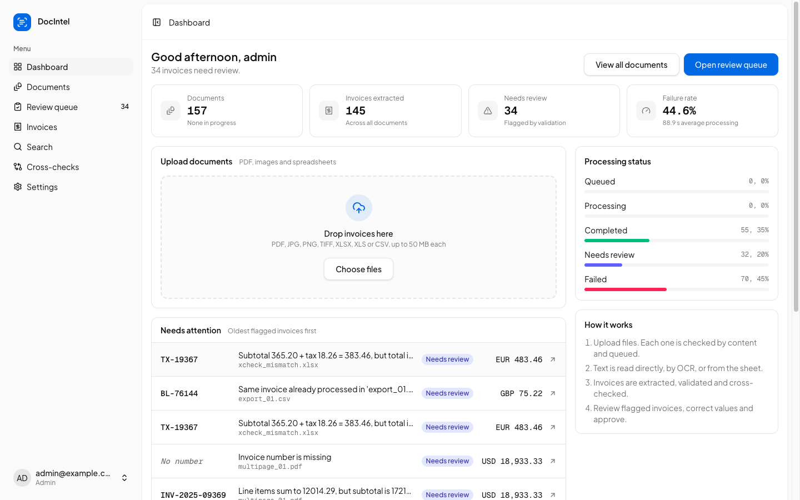 | 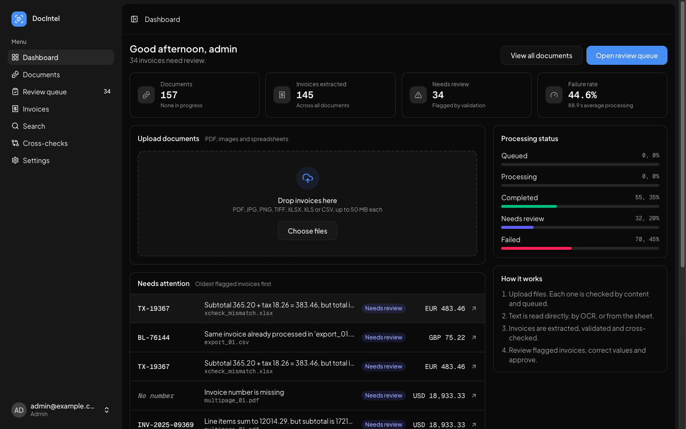 |
| **Invoice review** | **Documents** |
| 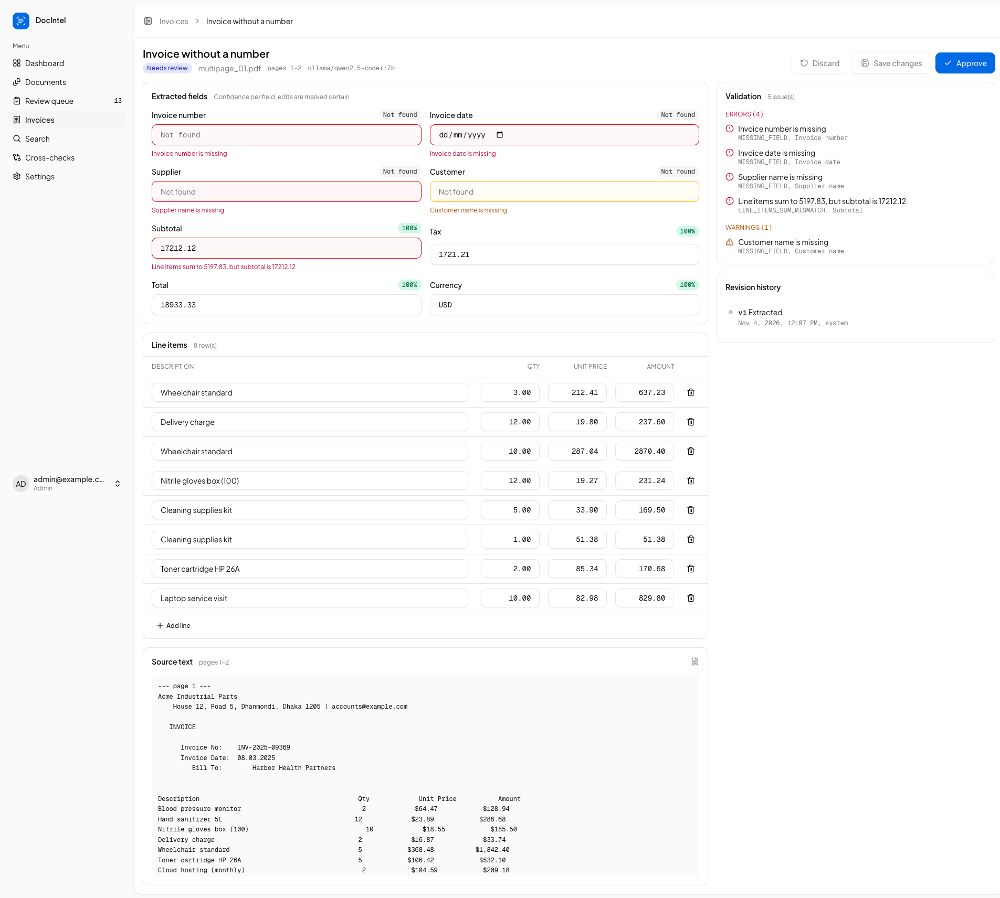 | 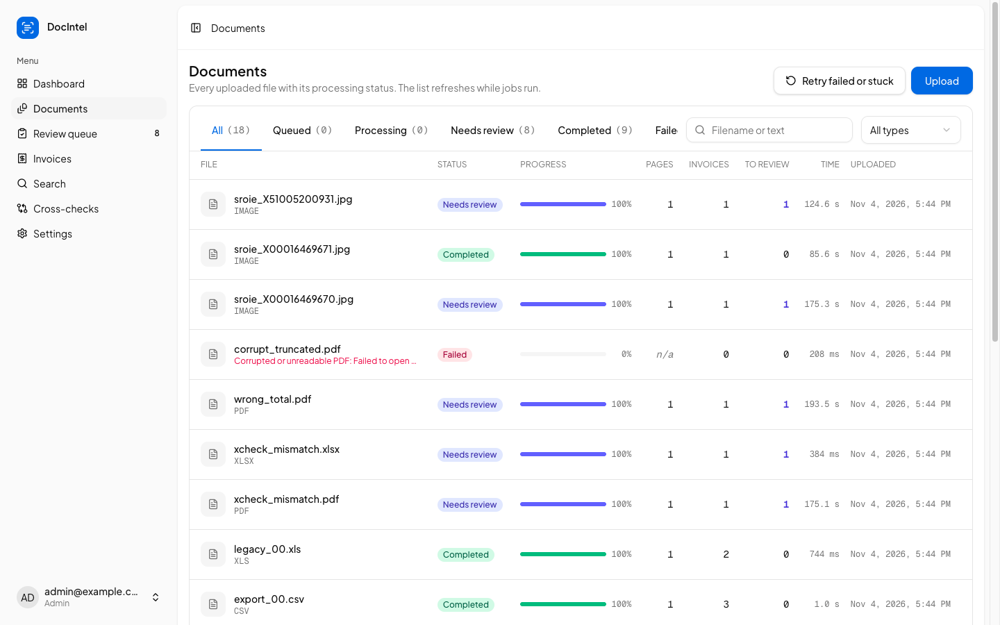 |
| **Cross-checks (PDF vs Excel)** | **Documents (dark)** |
| 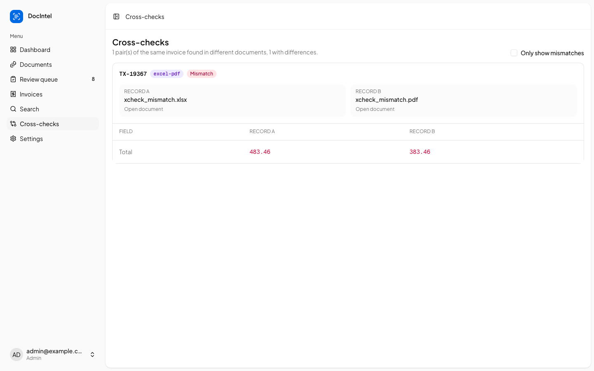 | 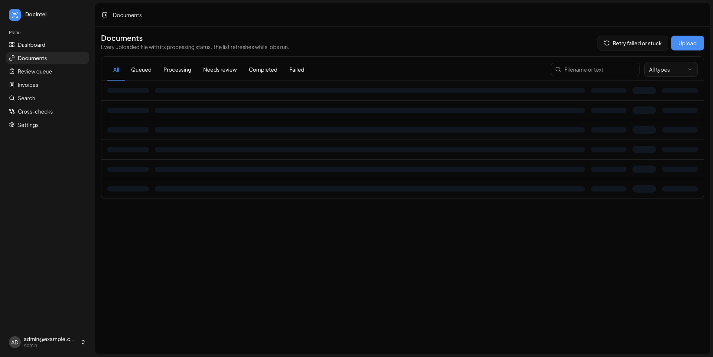 |

## 3. Installation

### 3.1 Installation flow

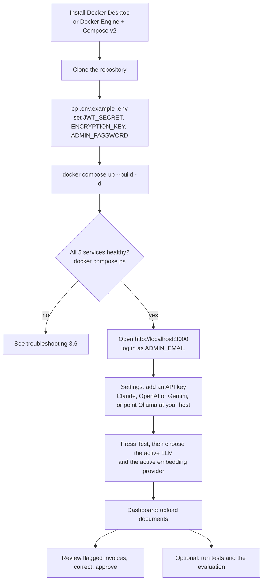

### 3.2 Prerequisites

| Need | Version | Notes |
|---|---|---|
| Docker + Compose | Docker 24+, Compose v2 | Everything else runs in containers |
| Free ports | 3000, 8000, 5433, 6379 | All bound to 127.0.0.1 only |
| An LLM | any one | API key for Claude, OpenAI or Gemini, or a local [Ollama](https://ollama.com) |
| Embeddings (for semantic search) | any one | OpenAI, Gemini or Ollama (`nomic-embed-text`). Claude has no embeddings API |

### 3.3 Quick start with Docker

```bash
git clone git@github.com:arifulhoque7/document-intelligence-system.git
cd document-intelligence-system

cp .env.example .env
# Fill in the secrets. To generate them:
python3 -c "import secrets;print('JWT_SECRET=' + secrets.token_urlsafe(48))"
python3 -c "import os,base64;print('ENCRYPTION_KEY=' + base64.urlsafe_b64encode(os.urandom(32)).decode())"

docker compose up --build -d
docker compose ps          # db, redis, api, worker, web should be running / healthy
curl localhost:8000/health # {"status":"ok","database":"ok","redis":"ok"}
```

| Service | URL |
|---|---|
| Web app | http://localhost:3000 |
| API docs (Swagger UI) | http://localhost:8000/docs |
| Health | http://localhost:8000/health |

### 3.4 First-run configuration

1. Log in with `ADMIN_EMAIL` / `ADMIN_PASSWORD` from `.env`. The admin is created on the first start.
2. Open **Settings**. For each provider you want, paste the key (or, for Ollama, set the base URL to `http://host.docker.internal:11434`), adjust the model if needed and press **Save**, then **Test**.
3. Choose the **active LLM** and the **active embedding provider**. Keys are encrypted at rest and only ever shown masked (`sk-…1234`).
4. Upload files on the **Dashboard**. Spreadsheets with invoice columns are processed without the LLM, so they work even before a key is set.
5. Optional: under **Settings > Users** create reviewer accounts (reviewers cannot change providers or users).

Default models: Claude `claude-opus-5-5` (low effort), OpenAI `gpt-5-mini` + `text-embedding-3-small`, Gemini `gemini-2.5-flash` + `gemini-embedding-001`, Ollama `qwen2.5:7b` + `nomic-embed-text`. All are editable per provider.

Scale processing with `docker compose up -d --scale worker=4`.

### 3.5 Local development (app outside Docker)

```bash
docker compose up -d db redis                  # Postgres on 127.0.0.1:5433, Redis on 127.0.0.1:6379
brew install tesseract                         # Debian/Ubuntu: apt-get install tesseract-ocr

cd backend
python3.12 -m venv .venv && .venv/bin/pip install -r requirements-dev.txt
cp ../.env .env
.venv/bin/uvicorn app.main:app --reload --port 8000
.venv/bin/celery -A app.worker worker --loglevel=INFO --pool=threads --concurrency=4

cd ../frontend
npm ci
npm run dev                                    # http://localhost:3000, proxies /api to API_URL (default http://localhost:8000)
```

### 3.6 Troubleshooting

| Symptom | Cause and fix |
|---|---|
| `bind: address already in use` on 5432/5433/6379 | Another Postgres or Redis is running. Stop it or change the host port in `docker-compose.yml` (and `DATABASE_URL` for local dev) |
| Celery on macOS crashes with `ValueError: not enough values to unpack` | Billiard's prefork pool on macOS. Run the worker with `--pool=threads` (Docker on Linux is unaffected) |
| Documents fail with "No active LLM provider" | Configure and activate a provider in Settings, then press **Retry failed or stuck** on Documents |
| Ollama unreachable from Docker | Use `http://host.docker.internal:11434` as the base URL and make sure Ollama listens on all interfaces (`OLLAMA_HOST=0.0.0.0`) |
| Semantic search returns 503 | No embedding provider is active; hybrid search falls back to keyword automatically |
| A document stays queued after a worker crash | Jobs with no progress for 10 minutes can be requeued from the UI or `POST /api/documents/reprocess-failed` |

## 4. Architecture

### 4.1 System context

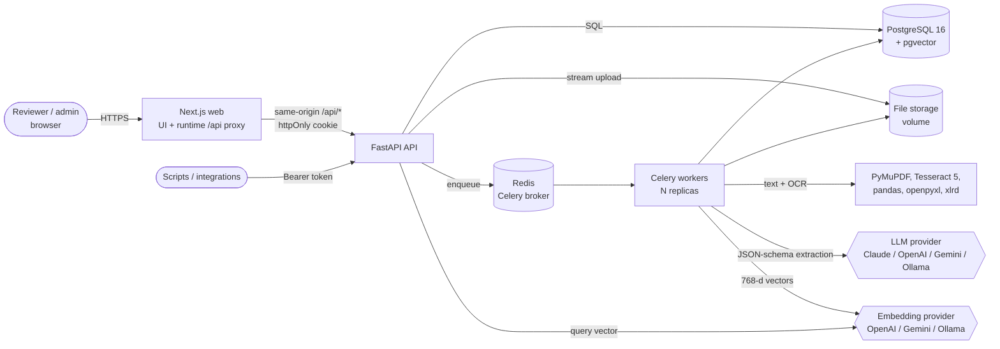

The API never runs OCR or LLM calls. It stores the upload, writes a `documents` row, enqueues a job and returns `202`. Workers do the slow work and record every stage in `processing_events`; the UI polls the document while it is active.

### 4.2 Deployment (Docker Compose)

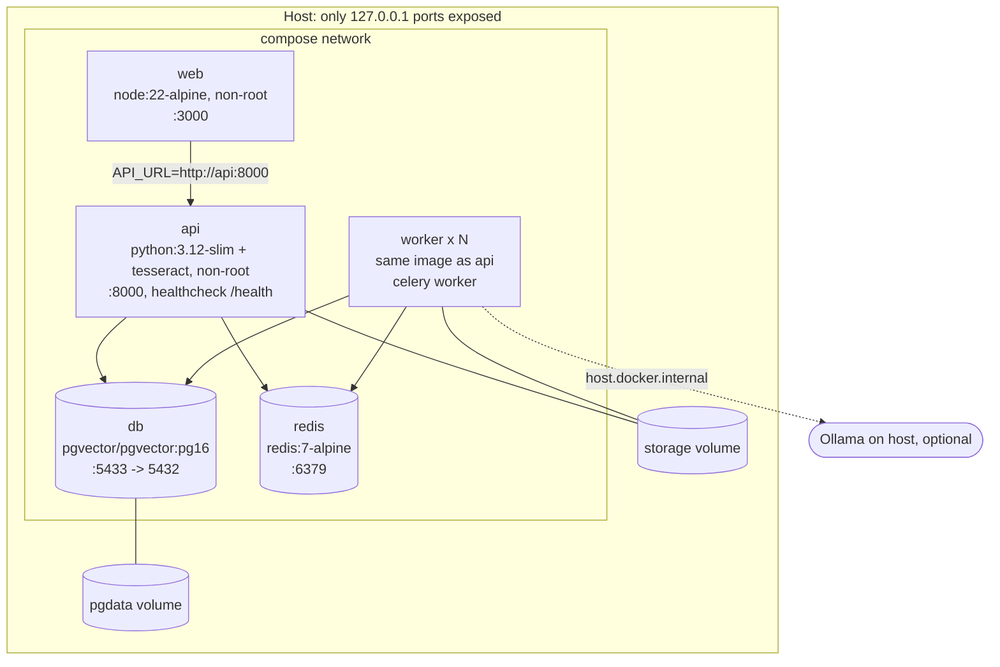

Start order is enforced by health checks: `db` and `redis` healthy, then `api` (creates the schema and the first admin), then `worker` and `web`.

### 4.3 Processing pipeline

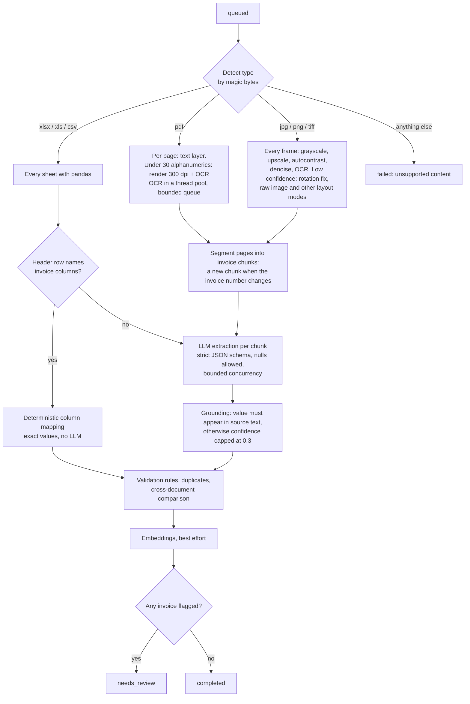

### 4.4 Request flow: upload to reviewed invoice

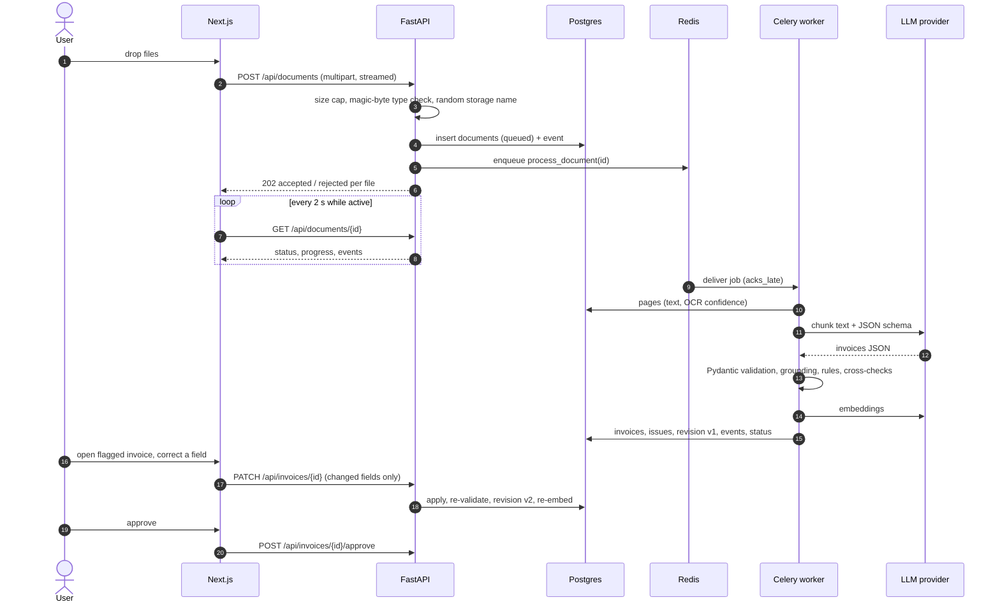

### 4.5 States

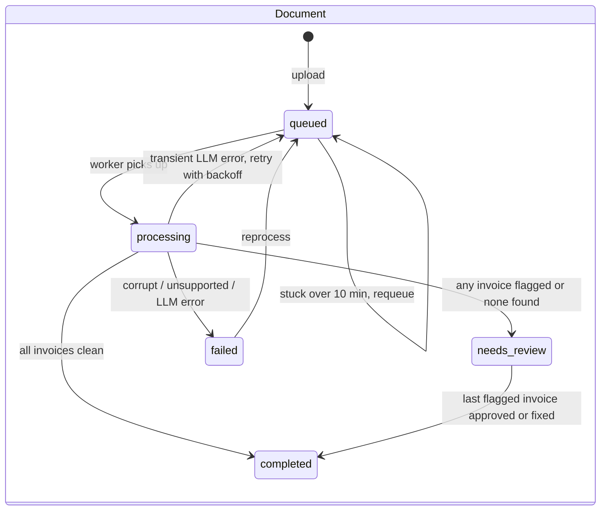

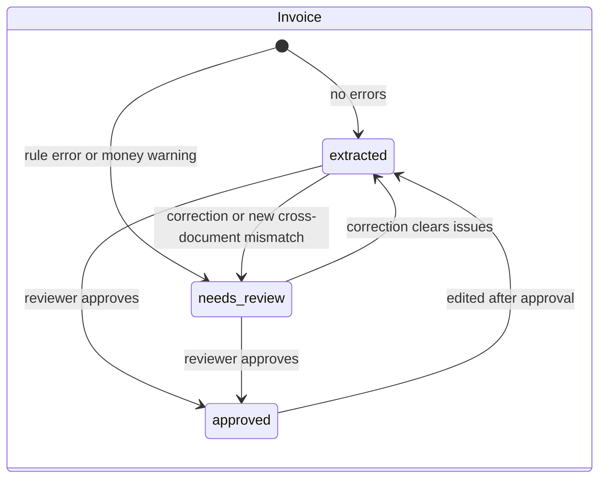

### 4.6 Data model

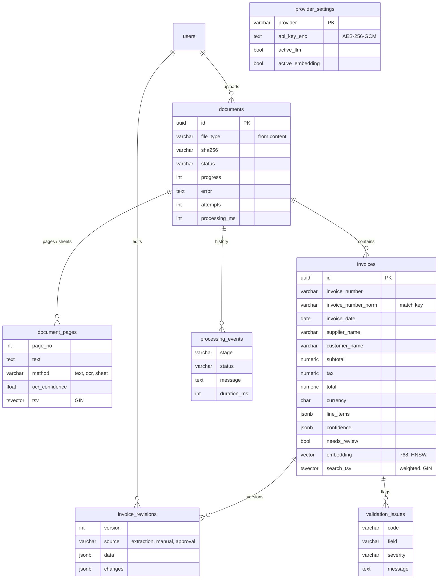

Money is `NUMERIC(18,2)`, search columns are generated (`GENERATED ALWAYS AS ... STORED`) so they never drift from the data, and every change to an invoice is kept as a full snapshot plus a field diff. Details: [docs/database-schema.md](docs/database-schema.md).

### 4.7 Backend layering

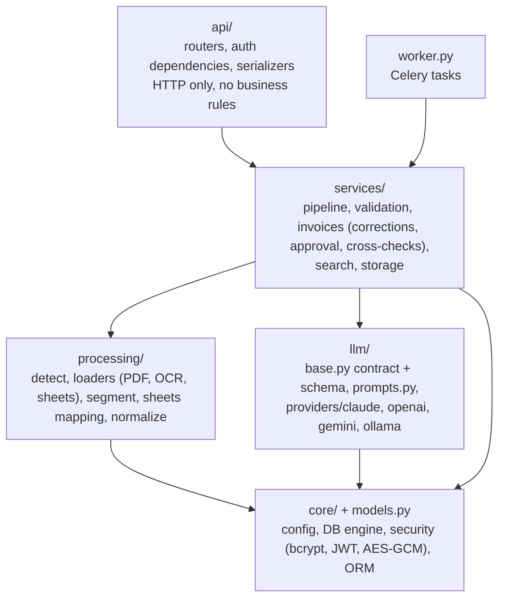

Dependencies point inwards only. The same services run from the API, the worker, the tests and the evaluation. Adding an LLM vendor is one file in `llm/providers/` implementing `complete_json` and `embed`, plus one registry line.

### 4.8 Frontend structure

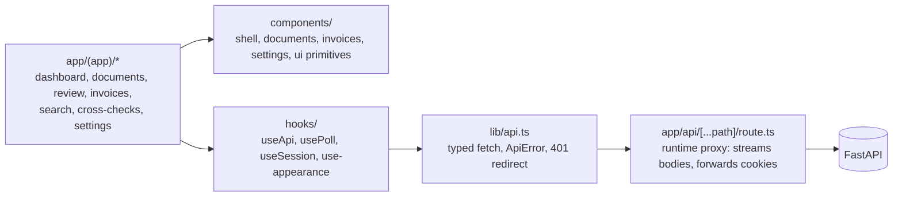

### 4.9 Failure handling

| Failure | Behaviour |
|---|---|
| Corrupted, encrypted, empty, blank or oversized file | Clean `ProcessingError` with a user-safe message; document `failed`; never retried automatically |
| LLM 429 / 5xx / timeout / connection error | Transient: Celery retries after 15 s, 30 s, 60 s, then `failed` with the reason |
| LLM 4xx, refusal, invalid JSON, schema violation | Permanent: `failed` with the provider's message; reprocess after fixing settings |
| Worker killed mid-job | `acks_late` + `reject_on_worker_lost` return the job to the queue; jobs with no progress for 10 minutes can be requeued |
| Same job delivered twice (broker or machine restart) | The worker skips any document that is no longer queued or processing, so a duplicate message never reprocesses a finished document or wipes reviewer corrections |
| Embedding provider down | Document still completes with a warning event; hybrid search falls back to keyword |
| Unexpected exception | Stack trace logged; document `failed` with a generic message (no internals leaked) |

## 5. Architecture decision records

Each record states the context, the decision, the alternatives that were weighed and the consequences accepted.

### ADR-001: One backend language: Python FastAPI + Celery

- **Status**: accepted
- **Context**: The brief suggests Node.js/NestJS with Redis/BullMQ, and also Python OCR tools and pandas/openpyxl. Every heavy step (OCR, PDF parsing, spreadsheets, LLM SDKs) is Python-first.
- **Decision**: FastAPI for the API, Celery on Redis for background jobs, all in Python.
- **Alternatives**: NestJS + BullMQ with a Python OCR microservice; all-Node with tesseract.js and SheetJS.
- **Consequences**: One runtime, one set of models, no internal HTTP hop between "API language" and "OCR language". Celery gives the same queue semantics as BullMQ (retries with backoff, late acks, horizontal workers). The deviation from the suggested NestJS stack is deliberate and recorded here.

### ADR-002: Asynchronous processing with late-acknowledged jobs

- **Status**: accepted
- **Context**: A 1000-page scanned PDF can take many minutes; HTTP requests must stay fast and workers can die.
- **Decision**: Upload returns `202`; one Celery task per document with `acks_late`, `reject_on_worker_lost`, prefetch 1, retry with exponential backoff only for transient LLM errors. Progress and history go to `processing_events`; the UI polls.
- **Alternatives**: synchronous processing; WebSockets/SSE for progress.
- **Consequences**: API latency is independent of document size, and workers scale with `--scale worker=N`. Redis re-delivers unacknowledged jobs only after its visibility timeout, so stale-job recovery (10 minutes without progress) is exposed in the UI and API. Polling is simpler than push and works behind any proxy.

### ADR-003: PostgreSQL + pgvector as the single data store

- **Status**: accepted
- **Context**: We need metadata, text, results, issues, history, keyword search and semantic search.
- **Decision**: PostgreSQL 16 with pgvector: GIN-indexed `tsvector` columns for keyword search, an HNSW cosine index for vectors, hybrid ranking by reciprocal rank fusion.
- **Alternatives**: MongoDB; a separate vector database (Qdrant, Pinecone); Elasticsearch.
- **Consequences**: One transaction covers an invoice and its vector, so they never drift; filters and similarity combine in one engine. A dedicated vector DB is a later step only if vectors reach a scale Postgres cannot serve.

### ADR-004: Text layer first, OCR only where needed, deterministic spreadsheets

- **Status**: accepted
- **Context**: OCR is slow and lossy; many PDFs have a text layer; exported ledgers have exact values.
- **Decision**: Per PDF page, use the text layer when it has at least 30 alphanumerics, otherwise render at 300 dpi and OCR. Images get clean-up and confidence-driven retries. Spreadsheets whose header row names invoice columns are mapped deterministically; only unrecognised sheets go to the LLM.
- **Alternatives**: OCR everything; send everything, including spreadsheets, to the LLM; a vision LLM for every page.
- **Consequences**: Digital PDFs read at about 200 pages/s, mixed PDFs are handled page by page, and spreadsheets are free, instant and exact. OCR quality limits scanned accuracy (see [results](#9-evaluation-results)).

### ADR-005: Strict JSON schema with nullable fields

- **Status**: accepted
- **Context**: The brief requires structured JSON and no invented values.
- **Decision**: One Pydantic schema (`ExtractionResult`) is sent as a strict JSON schema to every provider (Claude structured outputs, OpenAI `json_schema` strict, Gemini response schema, Ollama `format`). Every field is required but nullable, the prompt says "null if not printed", and the response is validated again with Pydantic.
- **Alternatives**: free-form JSON parsed with regexes; function calling per field.
- **Consequences**: The model can say "not present" instead of guessing; malformed output becomes a clear, retryable error rather than bad data.

### ADR-006: Grounding check against the source text

- **Status**: accepted
- **Context**: Model confidence is not reliable evidence of correctness.
- **Decision**: After extraction, each invoice number, party name and amount must appear in the source text (amounts in several print formats). If not, its confidence is capped at 0.3 and an `UNGROUNDED_VALUE` issue is raised. Values a reviewer typed are trusted.
- **Alternatives**: trust self-reported confidence; a second LLM pass to verify.
- **Consequences**: Hallucinated values are caught cheaply and deterministically. OCR misreads that are consistent in the text itself (for example `SI/` read as `S1/`) still pass, which is why validation rules and human review remain.

### ADR-007: Provider-neutral LLM layer configured at runtime

- **Status**: accepted
- **Context**: The user wanted to choose the provider from a settings page with masked keys; vendors and prices change.
- **Decision**: An `LLMProvider` protocol (`complete_json`, `embed`) with one adapter per vendor; each adapter maps its SDK errors to `LLMError(transient=...)`. Active provider, model and keys live in `provider_settings`, editable by admins in the UI.
- **Alternatives**: one hard-coded provider configured by environment variables; a third-party abstraction library.
- **Consequences**: Switching providers is a UI action, and adding one is a single file. Keys in the database require encryption at rest ([ADR-010](#adr-010-secrets-encrypted-at-rest-sessions-in-httponly-cookies)).

### ADR-008: Embeddings from a provider, pinned to 768 dimensions

- **Status**: accepted
- **Context**: Claude has no embeddings API; models have different native sizes.
- **Decision**: A separate "active embedding provider" (OpenAI, Gemini or Ollama), always requested at 768 dimensions. The model name is stored per row; changing the provider or model re-embeds every invoice in a background job; semantic queries only compare vectors from the current model.
- **Alternatives**: a local embedding model inside the worker; native dimensions with one column per model.
- **Consequences**: One column and one index for every provider. Semantic search depends on an external service, so hybrid search degrades to keyword when it is unavailable.

### ADR-009: Segment large documents by invoice number

- **Status**: accepted
- **Context**: A 1000-page PDF may hold hundreds of invoices; one LLM call per document would overflow context, one per page would split multi-page invoices.
- **Decision**: Start a new chunk when a page shows a different invoice number; pages without one (continuations) join the current chunk; chunks are capped at 60k characters. The LLM may still return several invoices per chunk. Chunks are extracted with bounded concurrency.
- **Alternatives**: one call per page; fixed page windows; LLM-based boundary detection.
- **Consequences**: Requests stay bounded and parallel, and multi-page invoices stay whole (1005-page benchmark: 480 chunks for 480 invoices). When OCR misreads a number, two invoices can share a chunk, which the list-shaped output still handles.

### ADR-010: Secrets encrypted at rest, sessions in httpOnly cookies

- **Status**: accepted
- **Context**: API keys are entered in the UI; the brief asks for strong security.
- **Decision**: Provider keys are AES-256-GCM encrypted with `ENCRYPTION_KEY`, never returned (masked only), editable by admins only. Sessions are JWTs in an httpOnly, SameSite=Strict cookie; the Next.js runtime proxy keeps the API same-origin. Bearer tokens are accepted for scripts.
- **Alternatives**: keys only in environment variables; tokens in localStorage.
- **Consequences**: A database leak alone does not expose keys, and the web app never stores the session token where page scripts can read it (login also returns the token in the body for API clients; the browser ignores it). `ENCRYPTION_KEY` rotation would need a re-encrypt step (not built).

### ADR-011: Human review as a first-class step

- **Status**: accepted
- **Context**: No extractor is perfect; financial data needs accountability.
- **Decision**: Any validation error, or a warning on a money field, sets `needs_review`. Reviewers correct values (only changed fields are sent), corrections are marked certain, everything is re-validated and versioned (`invoice_revisions`), and approval is an explicit, recorded action. Cross-document checks re-validate the earlier record too.
- **Alternatives**: auto-accept above a confidence threshold; overwrite results in place.
- **Consequences**: A full audit trail, and the review queue is the main working screen. About 10% of fully correct invoices were still sent to review in the evaluation (false alarms), the price of conservative rules.

### ADR-012: Measure with a reproducible, API-level evaluation

- **Status**: accepted
- **Context**: The brief asks for actual measured accuracy, time, success and failure rates.
- **Decision**: A synthetic generator renders invoices from known truth in every format and quality (seeded, reproducible); 20 real scanned receipts come from ICDAR 2019 SROIE. `eval/run_eval.py` drives the real stack through its public API and scores fields, detection, line items, rates and time. Tests use a deterministic fake LLM.
- **Alternatives**: hand-labelled samples only; unit-level scoring without the full stack.
- **Consequences**: Numbers reflect the deployed system, can be rerun for any provider, and the raw run is saved so scoring changes do not need new LLM calls.

## 6. API

All endpoints are under `/api` and need a session (cookie from `/api/auth/login`, or `Authorization: Bearer <token>`). Interactive docs at `/docs`.

| Method | Path | Purpose |
|---|---|---|
| POST | `/auth/login`, `/auth/logout`; GET `/auth/me` | Session |
| GET, POST | `/auth/users` | List and create users (admin) |
| POST | `/documents` | Upload many files (multipart field `files`); `202` with accepted and rejected files |
| GET | `/documents` | List: `status`, `file_type`, `q` (filename or full text), pagination |
| GET | `/documents/{id}` | Status, progress, processing history, pages, invoices |
| GET | `/documents/{id}/text` | Extracted text per page or sheet |
| GET | `/documents/{id}/file` | Original file (attachment) |
| POST | `/documents/{id}/reprocess` | Reprocess one document |
| POST | `/documents/reprocess-failed` | Requeue every failed or stuck document |
| GET | `/invoices` | Keyword filtering: `q`, `supplier`, `customer`, `invoice_number`, `currency`, `status`, `needs_review`, `date_from`, `date_to`, `min_total`, `max_total`, `document_id`, `sort`, pagination |
| GET, PATCH | `/invoices/{id}` | Result with issues and confidence; manual correction |
| POST | `/invoices/{id}/approve` | Reviewer sign-off |
| GET | `/invoices/{id}/history` | Revisions with field-level diffs |
| GET | `/search?q=&mode=keyword\|semantic\|hybrid` | Search |
| GET | `/cross-checks?only_mismatches=` | Same invoice in several documents, field by field |
| GET / PUT / PUT / POST | `/settings/providers`, `/settings/providers/{p}`, `/settings/active`, `/settings/providers/{p}/test` | Providers (admin writes) |
| GET | `/stats` | Dashboard numbers |

```bash
TOKEN=$(curl -s localhost:8000/api/auth/login -H 'content-type: application/json' \
  -d '{"email":"admin@example.com","password":"..."}' | python3 -c 'import json,sys;print(json.load(sys.stdin)["token"])')
curl -s localhost:8000/api/documents -H "Authorization: Bearer $TOKEN" -F files=@invoice.pdf -F files=@ledger.xlsx
curl -s "localhost:8000/api/search?q=wheelchair%20Dhaka&mode=hybrid" -H "Authorization: Bearer $TOKEN"
```

Extracted invoice (`GET /api/invoices/{id}`, abridged). Missing values are `null`, never guessed:

```json
{
  "invoice_number": "INV-2025-00279",
  "invoice_date": "2025-10-10",
  "supplier_name": "Northwind Traders",
  "customer_name": "Green Valley School",
  "subtotal": "2608.98",
  "tax": "391.35",
  "total": "3000.33",
  "currency": "USD",
  "line_items": [{"description": "Printer paper A3", "quantity": "1.00", "unit_price": "7.05", "amount": "7.05"}],
  "confidence": {"invoice_number": 0.98, "tax": 0.95, "customer_name": 0.97},
  "needs_review": false,
  "issues": []
}
```

## 7. Validation rules

| Code | Severity | Rule |
|---|---|---|
| `MISSING_FIELD` | error / warning | Invoice number, date, supplier and total required; customer, subtotal and currency recommended |
| `TOTAL_MISMATCH` | error | subtotal + tax differs from total (tolerance 0.01 or 0.5%) |
| `LINE_ITEM_MISMATCH` | error | quantity x unit price differs from the line amount |
| `LINE_ITEMS_SUM_MISMATCH` | error | line items do not add up to the subtotal (or total) |
| `NEGATIVE_AMOUNT`, `TAX_EXCEEDS_TOTAL` | error | Impossible amounts |
| `TAX_RATE_IMPLAUSIBLE` | warning | Tax above 40% of subtotal |
| `FUTURE_DATE`, `IMPLAUSIBLE_DATE` | error, warning | Date in the future or before 2000 |
| `UNKNOWN_CURRENCY` | warning | Not an ISO 4217 code |
| `LOW_CONFIDENCE` | warning | Model confidence below 0.6 |
| `UNGROUNDED_VALUE` | warning | Value not found in the document text |
| `DUPLICATE_INVOICE` | error / warning | Same supplier and number seen before (in the same document: error) |
| `CROSS_DOC_MISMATCH` | error | Same invoice in another document with different values |

## 8. Testing

```bash
docker compose up -d db redis
cd backend && .venv/bin/python -m pytest -q        # 72 passed (docs/test-results.txt)
cd ../frontend && npm test && npm run build         # form-diff unit test, type check, lint
```

Tests run against a real PostgreSQL database (`docintel_test`), execute Celery tasks inline, and replace the network LLM with a deterministic fake, so they are fast, free and repeatable.

| Suite | Covers |
|---|---|
| `test_processing.py` | Type detection by content; digital PDF; scanned PDF OCR; poor-quality images; multi-page PDF; multi-invoice splitting; multi-frame TIFF; XLSX with several sheets; XLS; CSV; corrupted, blank, encrypted files; page limit |
| `test_normalize_validation.py` | Amount, date and currency parsing; every validation rule; tolerance; grounding |
| `test_llm.py` | Strict schema; invalid JSON; schema violations; nulls stay null; hallucination detection; transient vs permanent error mapping; refusals; Gemini schema conversion |
| `test_api.py` | Auth, roles, rate limit, security headers; mixed uploads; status and results; corrections, history, approval; keyword filters; keyword, semantic and hybrid search; cross-document checks; failed-job reprocessing; transient-failure retries; corrupted and oversized uploads; encrypted, masked provider keys |

## 9. Evaluation results

Reproduce:

```bash
cd backend && .venv/bin/python -m devtools.synth ../eval/dataset/synthetic && cd ..   # synthetic set with known truth
backend/.venv/bin/python eval/fetch_public.py 20                                      # 20 real scanned receipts (SROIE)
backend/.venv/bin/python eval/run_eval.py --password <admin password>                 # full run through the API
backend/.venv/bin/python eval/run_eval.py --password <admin password> --rescore       # re-score the saved run
cd backend && .venv/bin/python ../eval/benchmark_large.py                             # 1000-page benchmark
```

**Run measured on 2026-11-04** with a small local model (Ollama `qwen2.5-coder:7b`, `nomic-embed-text`), 74 documents: 54 synthetic (every format and three scan qualities, cross-check pairs, a wrong-total invoice, corrupted files) and 20 real receipts. Full report: [eval/results/report.md](eval/results/report.md).

| Metric | Value |
|---|---|
| Document success rate (valid files) | 98.6% |
| Document failure rate (valid files) | 0.0% |
| Corrupted or blank files rejected cleanly | 4 / 4 |
| Field-level extraction accuracy | 96.3% |
| Invoices with every field correct | 91.0% |
| Invoice detection recall / precision | 99.0% / 99.0% |
| Line items precision / recall / F1 | 99.1% / 96.9% / 98.0% |
| Validation and cross-verification checks | 3 / 3 pass |
| Correct invoices still sent to review | 10.6% |

| Document kind | Accuracy |
|---|---|
| Digital, multi-page and bundled PDF, TIFF, XLSX, XLS | 100% on every field |
| CSV | 100%, except customer and tax at 88.9% |
| Scanned PDF and photos | 100% on amounts, dates, supplier; invoice number 75% (OCR reads `SI/` as `S1/`) |
| Real receipts (SROIE, labeled for supplier, date, total) | date 80%, total 70%, supplier 65% |

Processing time: spreadsheets 0.5 to 1.2 s per file (p50). LLM-bound documents took a median of about 100 s, because one local GPU served the 7B model to four concurrent workers while the queue was shared with interactive testing. These times measure that laptop, not the design; a hosted model removes the bottleneck.

**Large documents** (no LLM, fresh process per run, [eval/results/benchmark_large.md](eval/results/benchmark_large.md)):

| Case | Pages | Time | Pages/s | Chunks | Peak memory |
|---|---|---|---|---|---|
| Digital PDF, 480 invoices bundled | 1005 | 4.8 s | 209 | 480 | 115 MB |
| Scanned PDF, OCR with 4 threads | 100 | 56.4 s | 1.8 | 84 | 722 MB |

Read the scanned row as: OCR, not the design, is the throughput limit (about 0.55 s per page per worker at 300 dpi), and 16 of 100 single-page invoices had their number misread, so they shared a chunk with a neighbour; the extractor still returns them as separate invoices.

## 10. Security

- **Auth**: bcrypt hashes; JWT in an httpOnly, SameSite=Strict cookie (Bearer for scripts); roles `admin` and `reviewer`; admin-only provider and user management; login rate limit of 10 attempts per IP and email per 15 minutes.
- **Uploads**: type from content, not extension; streamed size limit; file count and page limits; Pillow decompression-bomb guard; random storage names outside any web root; originals served only as attachments.
- **Secrets**: provider keys AES-256-GCM encrypted, masked in every response; `.env` git-ignored; no secrets in images.
- **LLM**: document text is delimited and declared as data, the prompt tells the model to ignore instructions inside it, output must pass a strict schema before storage.
- **Data access**: parameterised SQL only (SQLAlchemy); whitelisted sort fields; Pydantic with `extra="forbid"` on every write body; the frontend never renders API strings as HTML.
- **HTTP and runtime**: `X-Content-Type-Options`, `X-Frame-Options: DENY`, `Referrer-Policy`, restrictive CSP on API responses; ports bound to 127.0.0.1; non-root containers.

## 11. Scaling, limitations and next steps

- **Scale out**: more workers (`--scale worker=N`), `OCR_THREADS` per job, `LLM_CONCURRENCY` per job. Separate queues for OCR-heavy and LLM-heavy work are the next step.
- **OCR**: Tesseract is set up for English; add language packs (for example `tesseract-ocr-ben`). Handwriting and very poor photos remain hard; a vision-LLM pass on low-confidence pages is the planned improvement and would also fix misread invoice numbers.
- **Platform**: schema is created on start (production: Alembic migrations); files on a Docker volume (production: object storage with signed URLs); add tracing and per-call LLM cost accounting.
- **Security**: key rotation for `ENCRYPTION_KEY`, trusted-proxy configuration so the login limiter sees client IPs behind the web proxy, SSO.

## 12. Project structure

```
.
├── docker-compose.yml          db, redis, api, worker, web
├── .env.example
├── backend/
│   ├── Dockerfile              python:3.12-slim + tesseract, non-root
│   ├── initdb/                 creates the test database
│   ├── app/
│   │   ├── main.py             FastAPI app, security headers, health, startup
│   │   ├── worker.py           Celery app and tasks
│   │   ├── models.py           ORM: the schema
│   │   ├── core/               config, db, security
│   │   ├── api/                routers, deps, serializers
│   │   ├── services/           pipeline, validation, invoices, search, storage
│   │   ├── processing/         detect, loaders, ocr, segment, sheets, normalize
│   │   └── llm/                base, prompts, providers/{claude,openai,gemini,ollama}
│   ├── devtools/synth.py       synthetic invoice generator with ground truth
│   └── tests/                  72 tests + fake LLM
├── frontend/
│   ├── app/                    pages, runtime API proxy
│   ├── components/             shell, documents, invoices, settings, ui
│   ├── hooks/, lib/            data fetching, types, API client
│   └── docs/screenshots/
├── eval/                       run_eval.py, fetch_public.py, benchmark_large.py, results/
├── docs/                       database-schema.md, schema.sql, test-results.txt
└── AI_DISCLOSURE.md
```

## 13. Configuration

| Variable | Default | Meaning |
|---|---|---|
| `JWT_SECRET`, `ENCRYPTION_KEY` | dev values | Must be set for any real use; `ENCRYPTION_KEY` is 32 bytes, base64 |
| `ADMIN_EMAIL`, `ADMIN_PASSWORD` | | First admin, created on first start |
| `MAX_FILE_MB`, `MAX_FILES_PER_UPLOAD`, `MAX_PAGES` | 50, 50, 2000 | Upload limits |
| `OCR_DPI`, `OCR_THREADS` | 300, 4 | OCR quality and parallelism per job |
| `LLM_CONCURRENCY`, `LLM_TIMEOUT_S` | 4, 120 | Parallel LLM calls per job and timeout |
| `EMBEDDING_DIM` | 768 | Vector size for every embedding provider |
| `COOKIE_SECURE` | false | Set to true behind HTTPS |
| `CORS_ORIGINS` | empty | Only needed if the frontend is not proxied |
| `API_URL` (web) | `http://localhost:8000` | Where the Next.js proxy forwards `/api` |
