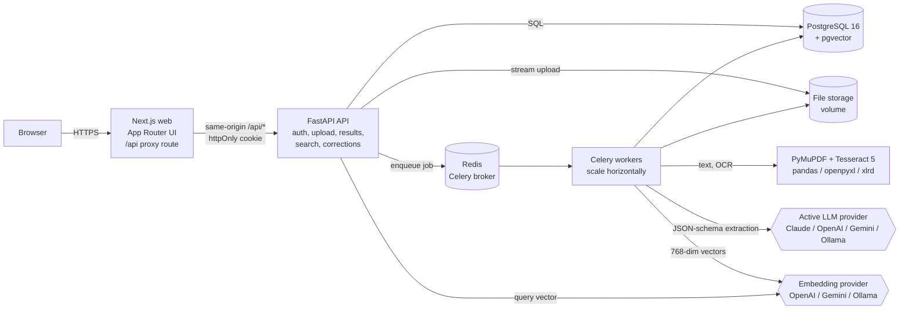
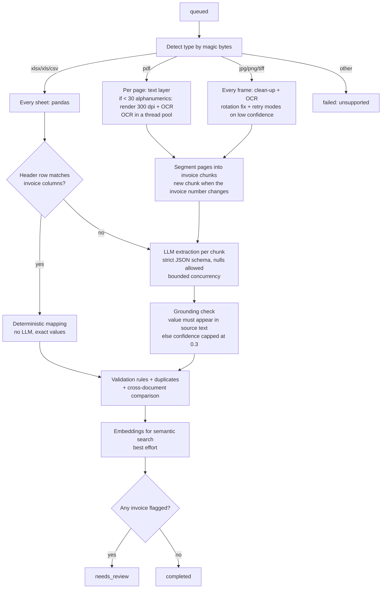

# Architecture

## System overview



The API process never runs OCR or LLM calls. It stores the upload, writes a `documents` row and enqueues a job, then returns `202`. Workers do the slow work and write progress to `processing_events`; the UI polls the document endpoint.

## Processing pipeline (one Celery task per document)



Failure handling:

| Failure | Behaviour |
|---|---|
| Corrupted, encrypted, empty, blank or oversized file | `ProcessingError` with a user-safe message; document `failed`; no retry |
| LLM 429 / 5xx / timeout / connection error | `LLMError(transient=True)`; Celery retries with backoff 15 s, 30 s, 60 s, then `failed` |
| LLM 4xx, refusal, invalid JSON, schema violation | `LLMError`; document `failed` with the provider's message; reprocess after fixing settings |
| Worker killed mid-job | `acks_late` + `reject_on_worker_lost` return the job to the queue; a job with no progress for 10 minutes can be requeued from the UI or `POST /api/documents/reprocess-failed` |
| Embedding provider down | Document still completes; event records the warning; semantic search falls back to keyword in hybrid mode |
| Unexpected exception | Logged with stack trace; document `failed` with a generic message (no internals leaked) |

## Layering (backend)

```
app/
  core/         config, database engine/session, password hashing, JWT, AES-GCM secret encryption
  models.py     SQLAlchemy ORM (single source of the schema)
  processing/   file -> text: type detection, PDF, OCR, spreadsheets, segmentation, value normalisation
  llm/          provider-neutral contract (base.py), prompts, one adapter per vendor (providers/*),
                registry + service functions (extract_invoices, embed)
  services/     business logic: pipeline, validation, invoices (corrections, approval, cross-checks),
                search (keyword, semantic, hybrid), storage
  api/          HTTP only: routers, dependencies (auth), serializers
  worker.py     Celery app and tasks
```

Dependencies point inwards: `api -> services -> processing / llm -> core`. Routers hold no business rules, so the same services run from the API, the worker, the tests and the evaluation.

Adding a new LLM vendor means one file in `llm/providers/` implementing `complete_json` and `embed`, plus one registry line.

## Key design decisions

| Decision | Alternatives considered | Why |
|---|---|---|
| Python FastAPI + Celery | NestJS + BullMQ + Python OCR service | One language end to end: OCR, pandas and LLM SDKs are all Python. A Node API would add a second runtime and an internal HTTP hop for no product gain. Celery on Redis gives the same queue semantics as BullMQ (retries, backoff, acks). |
| pgvector inside Postgres | Qdrant / Pinecone | Vectors live next to the rows they describe: one transaction, no dual-write drift, hybrid keyword + vector ranking in one query engine. HNSW index scales to millions of rows; a dedicated vector DB is a later step only if needed. |
| Text layer first, OCR only for pages without text | OCR everything | Digital PDFs are exact and about 100x faster to read. Mixed PDFs (some scanned pages) are handled per page. |
| Deterministic spreadsheet mapping | Send every sheet to the LLM | Exported ledgers have exact values; mapping is free, instant and 100% accurate. The LLM is used only for sheets that do not look like an invoice table. |
| Strict JSON schema with nullable fields | Free-form JSON | Every provider is constrained to the same schema; the model can say "not present" (null) instead of guessing. Output is validated again with Pydantic. |
| Grounding check | Trust the model's confidence | A value that is not printed in the source text is the clearest sign of a hallucination; its confidence is capped and the invoice is flagged. Values a reviewer typed are trusted. |
| Segment by invoice number | One LLM call per page / per document | Keeps each request bounded on 1000-page PDFs, keeps multi-page invoices together, and allows parallel calls. |
| Provider keys in the database, AES-256-GCM | Environment variables | The brief asks for switching providers from the UI. Keys are encrypted at rest with a server-side key, masked in every response, editable by admins only. |
| Embeddings pinned to 768 dimensions | Native size per model | One column and one index for every provider; the model name is stored per row and switching models triggers a re-embed job. |
| Polling for progress | WebSockets / SSE | Simple, cache-friendly and robust behind proxies; 2 s polling only while something is processing. |

## Scaling

- **Throughput**: `docker compose up --scale worker=N`. Each worker runs `--concurrency` processes; OCR inside a job uses `OCR_THREADS`; LLM calls inside a job use `LLM_CONCURRENCY`.
- **Large PDFs**: pages are rendered one at a time and OCR results are drained in bounded batches, so memory stays flat on 1000+ page files. `MAX_PAGES` caps abuse.
- **Database**: GIN indexes for full-text, HNSW for vectors, B-tree on filter columns (status, invoice number, date, total). List endpoints are paginated.
- **Next steps for production**: object storage (S3) instead of a volume, separate queues for OCR-heavy and LLM-heavy work, Alembic migrations, OpenTelemetry tracing, per-tenant rate limits and cost accounting per LLM call.

## Security

- Auth: bcrypt password hashes; JWT in an httpOnly, SameSite=Strict cookie (Bearer header also accepted for scripts); roles `admin` and `reviewer`; admin-only settings and user management; login rate limit (10 attempts per IP and email per 15 minutes).
- Uploads: type detected from content, not the extension; per-file size limit streamed (never fully buffered in memory); file count limit per request; page limit; Pillow decompression-bomb limit; files stored under random names outside any web root; originals served only as attachments.
- Secrets: provider keys AES-256-GCM encrypted with `ENCRYPTION_KEY`, never returned by the API (masked only); `.env` is git-ignored; no secrets in images.
- LLM: document text is delimited and declared as data, the prompt tells the model to ignore instructions inside it, and the output must pass a strict schema before anything is stored.
- Data access: SQLAlchemy parameterised queries only; sort fields whitelisted; Pydantic validation with `extra="forbid"` on every write body.
- HTTP: `X-Content-Type-Options`, `X-Frame-Options: DENY`, `Referrer-Policy`, a restrictive CSP on API responses; services bind to 127.0.0.1 in compose; containers run as non-root.
