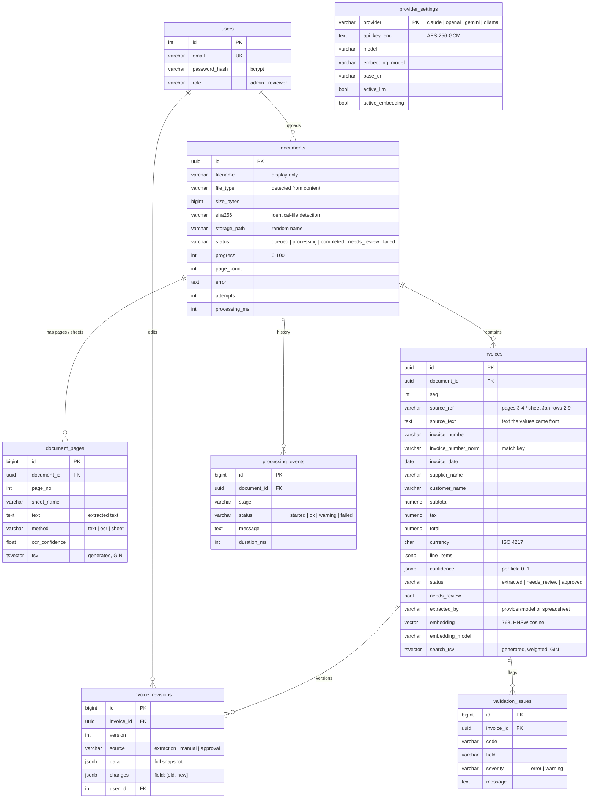

# Database schema

PostgreSQL 16 with the `pgvector` extension. The ORM models in `backend/app/models.py` are the source of truth; `docs/schema.sql` is the generated DDL (`pg_dump --schema-only`).

## Design notes

- **Money** is `NUMERIC(18,2)`, never float, so validation arithmetic is exact.
- **Search columns are generated** (`GENERATED ALWAYS AS ... STORED`): `invoices.search_tsv` weights invoice number and party names (A) above the source text (B); they can never drift from the data.
- **History**: `invoice_revisions` keeps a full snapshot per change (the original extraction is version 1) plus a field-level diff and the user; `processing_events` keeps every pipeline stage with timings, across reprocessing attempts.
- **Duplicates and cross-document checks** use `invoice_number_norm` (letters and digits only, upper case) plus a normalised supplier name, indexed.
- **Indexes**: GIN on both `tsvector` columns, HNSW (`vector_cosine_ops`) on `invoices.embedding`, B-tree on status, created_at, sha256, invoice number, date, total, needs_review and every foreign key.
- **Deletes cascade** from documents to pages, invoices, issues, revisions and events.

| Table | Purpose |
|---|---|
| `documents` | One uploaded file, its processing state and metadata |
| `document_pages` | Extracted text per PDF page, image frame or spreadsheet sheet |
| `invoices` | Structured extraction result (one document can hold many invoices) |
| `validation_issues` | Current rule violations per invoice |
| `invoice_revisions` | Version history: extraction, manual corrections, approvals |
| `processing_events` | Processing history and progress per document |
| `provider_settings` | LLM and embedding provider configuration with encrypted keys |
| `users` | Accounts and roles |
